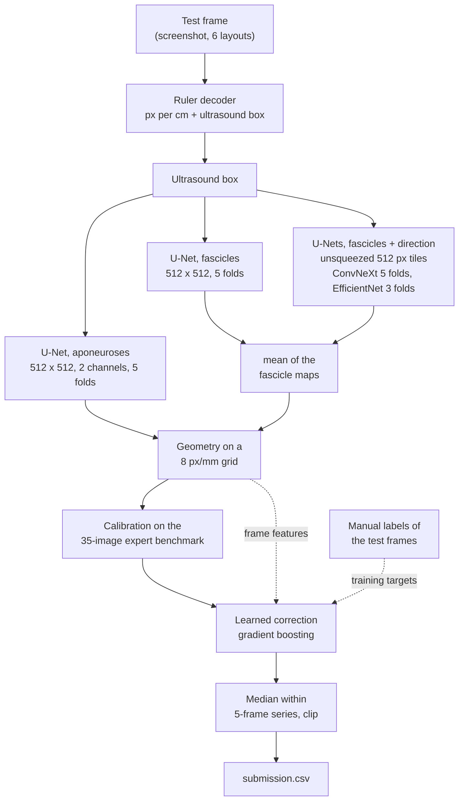
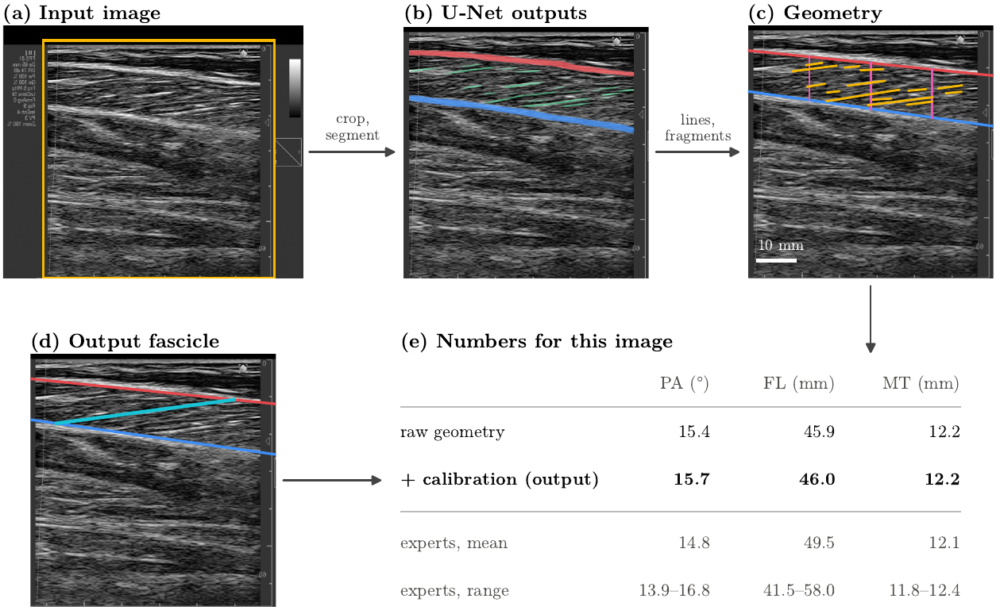
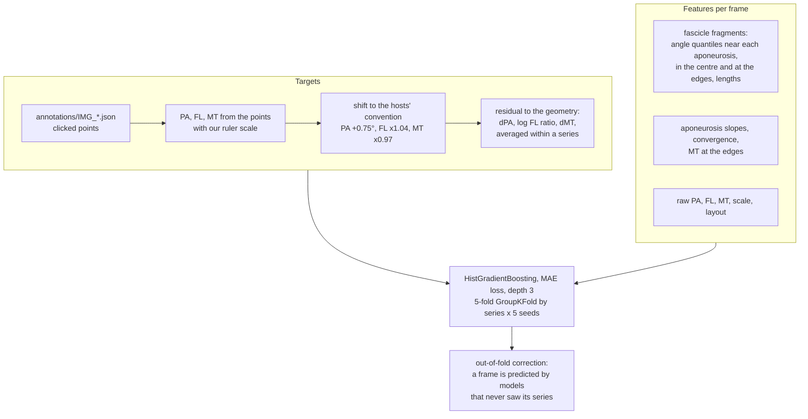

# UMUD challenge: muscle architecture from ultrasound

Code for the Kaggle competition
[UMUD Challenge: Muscle Architecture in Ultrasound Data](https://www.kaggle.com/competitions/umud-challenge-muscle-architecture-in-ultrasound-data).
Given a B-mode ultrasound image of a skeletal muscle, it estimates pennation angle (PA, degrees),
fascicle length (FL, mm) and muscle thickness (MT, mm).

Paper: M. Aldabergenov, A. Zhalgasbayev. *Where the error comes from in automated muscle architecture
measurement: a case study on the UMUD Kaggle challenge*. Preprint, Zenodo, 2026.
[doi:10.5281/zenodo.24321877](https://doi.org/10.5281/zenodo.24321877). The source and a copy of the PDF are
in `paper/`.

## Approach

The training set has segmentation masks and no PA/FL/MT values, so the numbers are not regressed straight
from the image. U-Nets find the aponeuroses and fascicles, hand-written geometry turns them into
numbers the way a rater measures in ImageJ, and a small model trained on manual measurements of the test
frames corrects that geometry.



One image through the pipeline, here the UMUD benchmark image with the median leave-one-out score:



The image goes through the networks (b), the geometry reads lines and fragments off their output (c, d), and calibration gives the final numbers, shown next to the seven expert raters (e). The learned correction is not applied to benchmark images. The figure is made by `paper/figures/fig_pipeline.py`. The rules of the competition do not allow publishing its images, so neither this repository nor the notebook shows them.

1. Scale. Test frames are screenshots with six screen layouts. `notebooks/umud_scale.py` recognises the
   layout and reads the depth ruler to get pixels per centimetre and the box of the ultrasound image.
   The decoder is adapted from AmbrosM's public notebook "UMUD Quick and Dirty".
2. Segmentation (segmentation_models_pytorch U-Nets, ImageNet encoders, 5-fold GroupKFold):
   - aponeuroses: ConvNeXt-Tiny, the ultrasound box squeezed to 512×512, the superficial and the deep
     aponeurosis as separate channels;
   - fascicles: the mean of three networks. One is the same square ConvNeXt-Tiny. The other two
     (ConvNeXt-Tiny, 5 folds, and EfficientNet-B4, 3 folds; `scripts/train_v9.py`,
     `notebooks/umud_aspect.py`) see the frame without squeezing: it is scaled to a shorter side of
     512, trained on random 512×512 crops and predicted with overlapping tiles. A squeezed box shows a
     15° fascicle at 12° to 19° depending on the scanner; here angles stay as they are. These two
     networks also predict the fascicle direction as (cos 2t, sin 2t) at every pixel, learned from the
     direction of the training mask lines. All networks are trained on the training set only.
3. Geometry, on the image resampled to 8 px per mm:
   - Aponeuroses are straight lines through their inner edges. When the deep channel shows several
     bands (two muscles on top of each other), the uppermost band with almost no fascicles below it is
     taken: the hosts measure the upper muscle.
   - MT is the perpendicular distance between the lines at 25, 50 and 75% of the width, averaged.
   - PA: each elongated fascicle fragment longer than 3 mm is fitted with a line. PA is the
     length-weighted median of their angles to the deep aponeurosis.
   - FL is mostly MT / sin(PA), with 20% weight on a straight fascicle line extended between the
     aponeuroses.
4. Calibration on the UMUD expert benchmark: 35 images measured by 7 raters with the same protocol as the
   test labels. At most one offset or scale per target, chosen by leave-one-out. On top, PA + 2° in
   total, chosen on the public leaderboard.
5. Learned correction, described below.
6. The median within each 5-frame series and clipping to the ranges given in the data description.

### Learned correction

The hand-written geometry was tuned on 35 images of one muscle from one scanner. On the test set its
errors are systematic: FL from MT / sin(PA) is too short where the aponeuroses converge, and small angle
errors blow up FL on Telemed frames. The hosts allow manual measurements of the test frames as training
or calibration data if declared as external data
([discussion](https://www.kaggle.com/competitions/umud-challenge-muscle-architecture-in-ultrasound-data/discussion/690868)).
All 309 test frames were measured by hand by a team member (`annotations/`: two points per aponeurosis
and one fascicle per frame; see `annotations/README.md`).



- Labels are recomputed from the clicked points with our ruler scale. The annotator measures in their
  own way, so these values are shifted to the hosts' convention: the shift is the one that makes local
  score differences between our 8 scored submissions match the public leaderboard (correlation 0.98).
- Within a 5-frame series the frames are almost identical but were labelled separately; their spread
  (PA 0.6°, FL 4.2 mm, MT 0.15 mm) is the annotator's noise, so targets are averaged per series.
- Predictions are cross-fitted by series. The local score below is honest, and the model cannot simply
  repeat the annotator's labels for the frames it predicts.

The correction mostly fixes FL (local MAE 8.9 → 7.3 mm). PA barely changes: a correction cannot recover
fascicles the network does not see, which is where the remaining error is.

## Results

Final standing, team Mixture of Experts, final submission v9 (all three fascicle nets):

| Leaderboard | Score | Rank |
|---|---|---|
| Public, at the close on 14 November 2026 | 0.383 | 281 of 690 |
| Private | not released yet | |

The private leaderboard is released after the organisers verify the results; this table will be updated then.
The paper in `paper/` was written before that and does not contain the private score.

| Version | Local, manual labels | Public LB |
|---|---|---|
| v1: one fold, PA from a structure tensor on the fascicle map | | 0.563 |
| v2: PA from fascicle fragments | 0.493 | 0.529 |
| v2 with PA + 2° | 0.421 | 0.480 |
| v3: 5 folds, PA + 2° | 0.414 | 0.441 |
| v4: v3 + deep aponeurosis chosen by fascicles | 0.378 | not submitted |
| v5: v4 + learned correction | 0.326 | 0.385 |
| v7: v5 + aponeurosis net fine-tuned on the manual test lines, rotation TTA | 0.309 | 0.395 |
| v9a: v5 with the unsqueezed ConvNeXt fascicle net instead of the square one | 0.314 | 0.391 |
| v9, mix of square and unsqueezed ConvNeXt fascicle nets | 0.321 | 0.394 |
| v9, mix of all three fascicle nets (final) | 0.320 | 0.383 |

Score is `(MAE_PA / 6 + MAE_FL / 12 + MAE_MT / 3) / 3`, lower is better. The local column compares with
the manual labels shifted to the hosts' convention, over all 309 frames; the public leaderboard uses a
random third of them. On the expert benchmark a single rater scores 0.25 to 0.48 against the other six,
and DL_Track scores 0.33.

Differences of 0.01 to 0.02 are below what we can measure. The public part is about 100 frames: for a
random third, the score difference of two of our submissions varies by about 0.01. The manual labels come
from one annotator with one fascicle per frame, and anything trained directly on these clicks looks better
locally than it is (v7). The expert benchmark has 35 images of one muscle from one scanner.

What did not help:
- Fine-tuning the aponeurosis net on the manual lines of the test frames (cross-fitted by series): Dice
  on held-out test series went up from about 0.66 to 0.77 and the local score improved, the public score
  got worse. The net learned where this annotator clicks, not where the hosts do.
- The aponeurosis net on unsqueezed tiles: much worse (local 0.37 instead of 0.33). On tall frames a
  512 px tile often shows only one aponeurosis, and the net cannot tell which one it is.
- Rotation TTA (±4°) for the fascicle net, PA from a Radon projection of the fascicle map or from a Gabor
  filter bank, FL as a straight line between the aponeuroses as an extra feature: no change after the
  learned correction.
- PA from the direction head (`pa_method="orient"`): 1.26° MAE against 1.30° from fragments on the
  manual labels, the same total score after the learned correction; fragments stay the default.

## Repository layout

```
notebooks/umud_pipeline.ipynb   the whole pipeline: data, training, geometry, benchmark, submission
notebooks/umud_scale.py         depth-ruler decoder for the test screen layouts
notebooks/umud_manual.py        PA, FL and MT from manually clicked points
notebooks/umud_aspect.py        unsqueezed tiles, the fascicle direction head and its PA
app/                            local viewer of model annotations, plus a page for manual measurement
annotations/                    manual measurements of all 309 test frames, one JSON per frame
umud-annotator/                 the standalone browser tool these were made with (see its README.txt)
labels/                         labels made with the app's annotation page, one JSON per annotator
scripts/                        experiments and figures, listed below
eda/                            figures and the per-frame scale table of the test set
paper/                          the paper: LaTeX source, figures, the script that checks its numbers
```

| Script | What it does |
|---|---|
| `run_notebook.py` | executes a notebook cell by cell and saves it after every cell |
| `make_variant.py` | rebuilds a submission from cached network outputs with `CFG` overrides, about a minute |
| `manual_labels.py` | turns manual labels into a table and scores submissions against it |
| `train_v9.py`, `infer_v9.py` | the unsqueezed fascicle nets with the direction head; maps for comparisons |
| `finetune_apo_test.py`, `rotation_tta.py` | fine-tuning on the manual test lines and rotation TTA (did not help) |
| `analyze_labels.py` | labels vs the public LB, annotator noise, scale check, error breakdown by layout |
| `label_models.py`, `learned_geometry.py` | prototypes of the label-based correction (linear, then boosting) |
| `geom_v4.py` | prototype of the deep-aponeurosis choice and per-fragment FL, kept for reference |
| `bench_vs_pairs.py` | scores the pipeline against every pair of benchmark raters (the test label is a mean of two) |
| `infer_example.py` | input / prediction / expert values figure for a few benchmark images |
| `check_scale.py`, `check_aspect.py` | checks of the ruler decoder and of pixel aspect ratio |
| `audit_series.py` | splits the PA error of the worst Telemed series into aponeurosis, fascicle choice and drawn line |
| `eda_*.py`, `fig_scale_explain.py` | dataset inventory and local figures in `eda/`; these show competition frames and stay out of git |

## Setup

Python 3.12. The pinned torch is the CUDA 12.8 build; for another GPU install torch from pytorch.org
first.

```bash
python -m venv .venv
```

```bash
.venv/Scripts/pip install -r requirements.txt
```

Competition data (needs a Kaggle API key and accepted competition rules):

```bash
kaggle competitions download umud-challenge-muscle-architecture-in-ultrasound-data -p data
```

Unzip it to `data/raw/`, so that `data/raw/test_images_v2/test_set_v2/` exists.

Expert benchmark: download `benchmark_dataset_architecture_v0.1.0.zip` from the folder
"Expert Analysed Benchmark Image Datasets" at https://osf.io/xbawc and unzip it to
`external/osf_umud/benchmark_dataset_architecture_v0.1.0/`.

## Running

Open `notebooks/umud_pipeline.ipynb` with the `.venv` kernel and run all cells. The first run caches the
training set in `work/` (about 2 minutes), trains 5 folds of both networks (2.5 to 3 hours on a laptop
RTX 5080 limited to 60% of its memory), evaluates on the benchmark and writes `work/submission.csv`.
Folds with an existing `work/{apo,fasc}_fold{k}.pt` are skipped. With all weights in place, including
`work/v9/`, a full run takes about 7 minutes on the same GPU; the outputs saved in the notebook come from such a
run. It reproduces the submitted file up to the nondeterminism of GPU inference: mean differences of 0.06° PA,
0.4 mm FL and 0.02 mm MT, and the same local score of 0.320.

Without Jupyter:

```bash
python scripts/run_notebook.py notebooks/umud_pipeline.ipynb notebooks
```

The unsqueezed fascicle nets are trained by a separate script (about 3.5 hours for 5 + 3 folds); the
notebook picks their weights up from `work/v9/` and averages them in (`CFG["v9"]`):

```bash
python scripts/train_v9.py fasc_cnx fasc_eff
```

Settings live in the `CFG` dict at the top of the notebook: `folds`, `retrain`, `pa_method`,
`pa_offset`, `fl_scale`, `h_over_v`, `v9` and `learned` (the label-based correction). The last section reads
`annotations/`, prints the local score with and without the correction and writes `work/submission.csv`;
the submission without it goes to `work/submission_base.csv`. `UMUD_SMOKE=1` runs everything on 50 images with one epoch,
which is enough to check that the code works.

A full run also stores the network outputs in `work/bench_probs.pkl` and `work/test_probs.pkl`. After
that, geometry and calibration changes can be tried without the GPU:

```bash
python scripts/make_variant.py work/sub_pa15.csv pa_offset=1.5
```

## Viewer

`app/` is a small Streamlit app for looking at what the models found on a test frame (or on an uploaded one):
aponeuroses, the fascicle fragments behind PA, the three MT measurements and the final numbers. A GPU is
not needed: on CPU one fold annotates a frame in about 2 seconds.

### Running it from scratch

1. Clone the repository:

   ```bash
   git clone https://github.com/Aldabergenov1/umud-challenge.git
   ```

   ```bash
   cd umud-challenge
   ```

2. Create the environment and install the dependencies (Python 3.12). On Windows:

   ```bash
   python -m venv .venv
   ```

   ```bash
   .venv\Scripts\activate
   ```

   ```bash
   pip install -r requirements.txt
   ```

   On Linux or macOS the second command is `source .venv/bin/activate`. On macOS, or to skip the large
   CUDA build on a machine without an NVIDIA GPU, first run `pip install torch==2.8.0 torchvision==0.23.0`
   and delete the `--extra-index-url`, `torch` and `torchvision` lines from `requirements.txt`.

3. Put the test frames in `data/raw/`, so that `data/raw/test_images_v2/test_set_v2/IMG_00001.tif`
   exists. They come from the competition download described in [Setup](#setup).

4. Put the model weights in `work/`: `apo_fold0.pt` and `fasc_fold0.pt` are enough, all five folds give
   the same masks as the submission. The weights are not in git (122 MB each). Train them with the
   notebook or ask the repository owner for them.

5. Start the app from the repository root:

   ```bash
   streamlit run app/app.py
   ```

   The browser opens http://localhost:8501. The first start reads the depth rulers of all 309 test
   frames, which takes about a minute; later starts reuse that.

### Manual measurement page

The second page of the app ("annotate" in the sidebar) is for measuring the test frames by hand. It does
not need model weights. The hosts allow manual measurements of the test frames as training or calibration
data, declared as external data
([discussion](https://www.kaggle.com/competitions/umud-challenge-muscle-architecture-in-ultrasound-data/discussion/690868)).

Only one frame per 5-frame series is shown (197 frames instead of 309); its label is used for the whole series. The split of frames between annotators lives in `ANNOTATORS` at the top of `app/pages/annotate.py`.

PA, FL and MT come from the clicks in `notebooks/umud_manual.py`: straight aponeurosis lines, MT at 25/50/75 % of
the width, each fascicle extended to both aponeuroses, mean over fascicles.

#### Using the labels

```bash
python scripts/manual_labels.py
```

collects all label files into `labels/manual_mean.csv`, prints how much the annotators disagree on the
shared frames and scores every submission in `work/` against the labels with the competition metric.

### If it does not start

| Message | What to do |
|---|---|
| "... нет весов моделей ..." | weights are missing from `work/`, see step 4 |
| "Нет тестовых кадров ..." | the frames are not in `data/raw/test_images_v2/`, see step 3 |
| port 8501 is already in use | `streamlit run app/app.py --server.port 8502` |
| `ModuleNotFoundError` | the virtual environment is not activated, see step 2 |

What the colours mean and what the sidebar settings do: [app/README.md](app/README.md) (in Russian).

## Known issues

- The learned correction rests on one annotator, one fascicle per frame, and on a shift to the hosts'
  convention fitted on 8 leaderboard scores. More fascicles per frame and a second annotator would make
  both firmer.
- On the Telemed layout with the ruler on the left (90 test frames) the bottom ticks give a horizontal
  scale 0.905 times the vertical one. The hosts state that pixels are square and the vertical scale applies, so the
  pipeline treats them as square (`h_over_v`).
- The ultrasound box is squeezed to 512×512 without keeping its aspect ratio, so Lumify frames reach the
  network stretched about 1.4 times horizontally. Measurements are taken after mapping back to the
  original geometry, but the network still sees distorted angles.
- The ruler decoder only knows the screen layouts of the test set. A frame from another device raises an
  error.
- On benchmark image im_19 the network takes an intramuscular band for the deep aponeurosis, which gives a
  10 mm MT error. Nothing checks for this yet.

## Data and credits

- Competition data: CC BY-NC-SA 4.0, available to participants on Kaggle and not included in this repository. Notebook outputs do not show competition images.
- UMUD expert benchmark: Ritsche et al., CC BY 4.0, https://osf.io/xbawc.
- The depth-ruler decoder follows AmbrosM's Kaggle notebook "UMUD Quick and Dirty".
- Manual measurements of the test frames (`annotations/`) were made by Arman Zhalgasbayev. They are external data in the sense of the competition rules, and the host allows this use when it is declared (discussion 690868). They are licensed under CC BY-NC-SA 4.0.

## License

The code is released under GPL-3.0, see `LICENSE`. `annotations/` has its own license, see above.

## Authors

Makhambet Aldabergenov and Arman Zhalgasbayev, team Mixture of Experts. To cite this work, see `CITATION.cff`.
